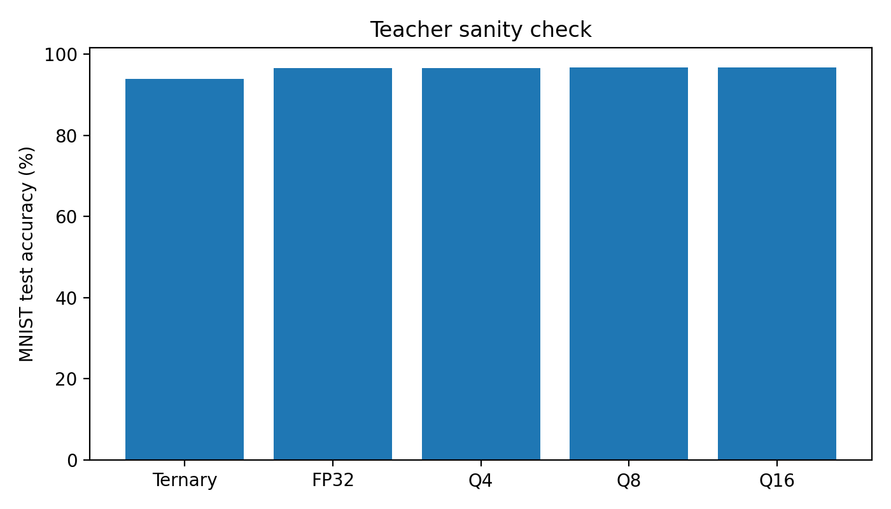
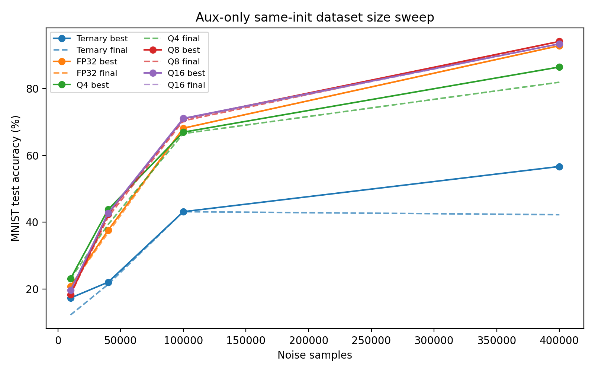
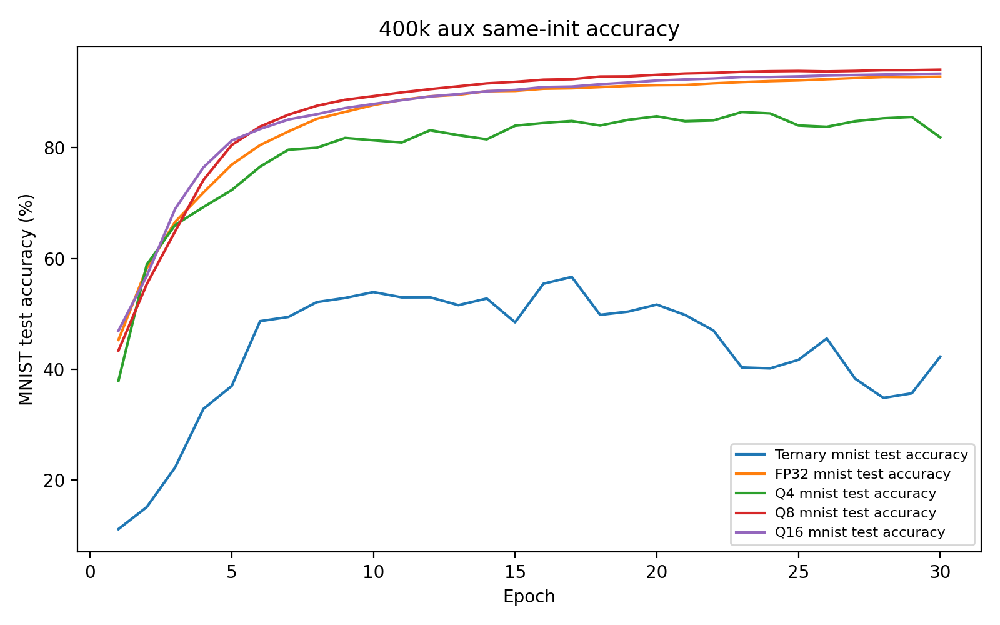
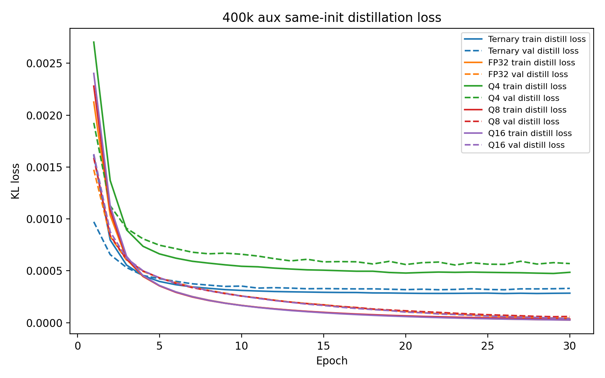
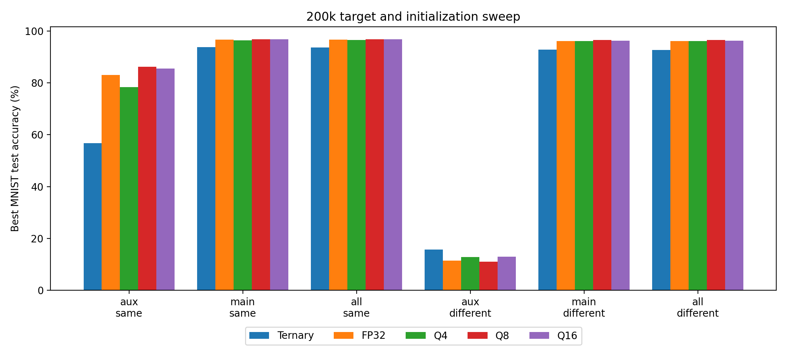
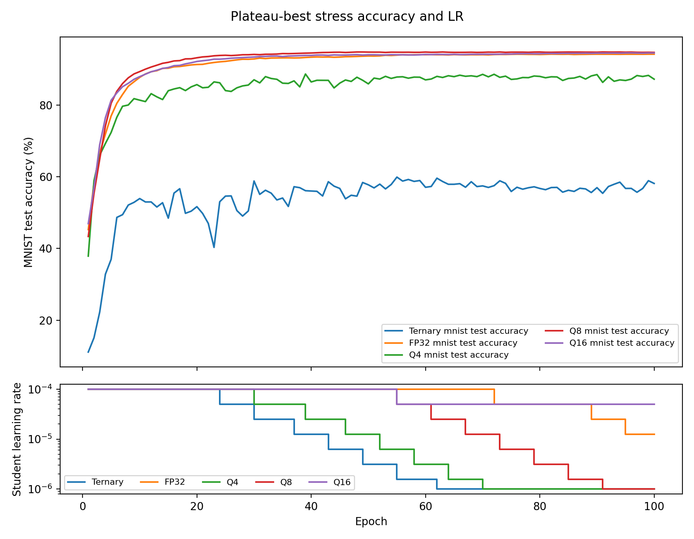
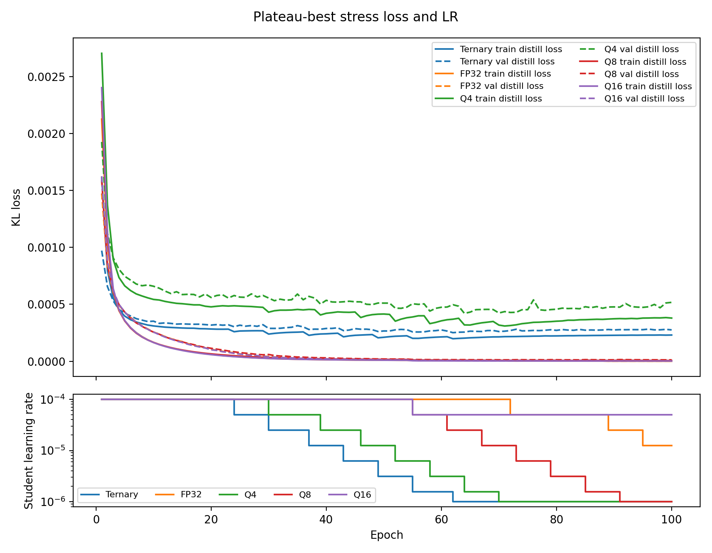

# MNIST Subliminal Learning Across Weight Precision

## Setup

The continuation uses the same `784 -> 256 -> 256 -> 13` MLP, centered MNIST/noise inputs in `[-1, 1]`, 5 teacher epochs, 30 student epochs, Adam, batch size 256, teacher LR `1e-3`, student LR `1e-4`, and a 20% validation split. The first 10 outputs are digit logits; the last 3 are auxiliary logits. Each model has its own teacher and cached noise logits, while seeds and the experiment protocol are held fixed.

| Model | Hidden layers | Forward weights |
|---|---|---|
| Ternary | `BitLinear + ReLU` | abs-mean-scaled `{-1, 0, +1}` |
| Q4 | `QuantizedLinear + ReLU` | 4-bit symmetric uniform |
| Q8 | `QuantizedLinear + ReLU` | 8-bit symmetric uniform |
| Q16 | `QuantizedLinear + ReLU` | 16-bit symmetric uniform |
| FP32 | `nn.Linear + ReLU` | full precision |

The quantized layers use FP32 latent trainable weights and straight-through gradients. Biases and activations remain FP32. Q4/Q8/Q16 use the same per-tensor quantizer at different resolutions; the ternary layer uses a different scaling rule. These experiments measure training behavior, not compressed inference speed or memory use.

## Teacher Check

All teachers learned MNIST before noise-logit distillation.

| Teacher | Final test accuracy |
|---|---:|
| Ternary | 93.86% |
| Q4 | 96.57% |
| Q8 | 96.80% |
| Q16 | 96.82% |
| FP32 | 96.61% |

## Dataset Size Sweep

Same-init students were trained only on auxiliary logits from random noise. Each cell shows **best / final** MNIST test accuracy over 30 epochs.

| Noise samples | Ternary | Q4 | Q8 | Q16 | FP32 |
|---:|---:|---:|---:|---:|---:|
| 10k | 17.30 / 12.22% | 23.07 / 23.06% | 18.32 / 18.26% | 19.59 / 19.50% | 20.78 / 20.73% |
| 40k | 22.03 / 21.36% | 43.76 / 39.29% | 42.41 / 41.52% | 42.72 / 42.52% | 37.58 / 36.82% |
| 100k | 43.13 / 43.13% | 66.93 / 66.50% | 70.93 / 70.33% | 71.06 / 70.80% | 68.12 / 68.12% |
| 400k | 56.66 / 42.23% | 86.43 / 81.88% | 94.08 / 94.08% | 93.36 / 93.36% | 92.82 / 92.82% |

At 400k samples, Q8 and Q16 are near FP32 and remain stable through epoch 30. Q4 transfers much more strongly than ternary but shows a smaller best-to-final decline. The small-data results are not strictly ordered by precision.

## 400k Aux Same-Init Curves

The accuracy curves show when each model learns the digit signal and whether it persists. The KL curves show optimization on the noise targets; lower KL loss does not by itself imply higher MNIST accuracy.

## 200k Target and Initialization Sweep

Best MNIST test accuracy over 30 epochs:

| Target / init | Ternary | Q4 | Q8 | Q16 | FP32 |
|---|---:|---:|---:|---:|---:|
| Aux, same | 56.75% | 78.37% | 86.17% | 85.53% | 83.00% |
| Main, same | 93.68% | 96.32% | 96.78% | 96.79% | 96.58% |
| All, same | 93.60% | 96.43% | 96.79% | 96.77% | 96.60% |
| Aux, different | 15.81% | 12.92% | 11.14% | 13.00% | 11.52% |
| Main, different | 92.80% | 96.08% | 96.48% | 96.23% | 96.09% |
| All, different | 92.70% | 96.09% | 96.43% | 96.28% | 96.08% |

Main/all-logit distillation succeeds with either initialization. The auxiliary-only signal is strong with the teacher's initialization and weak with a different initialization for every model.

## Plateau-Best Stress Test

These runs start fresh with 400k aux same-init samples, student LR `1e-4`, and 100 epochs. On an accuracy plateau, training reloads that run's own best checkpoint, lowers LR, and continues.

| Model | Best accuracy | Best epoch | Final accuracy |
|---|---:|---:|---:|
| Ternary | 59.90% | 55 | 58.13% |
| Q4 | 88.62% | 39 | 87.19% |
| Q8 | 94.77% | 91 | 94.65% |
| Q16 | 94.51% | 96 | 94.49% |
| FP32 | 94.16% | 82 | 94.15% |

Q4 remains well above ternary, while Q8 and Q16 finish close to FP32. Best epochs are selected using MNIST test accuracy, and the plateau scheduler also monitors it. These results are diagnostic comparisons rather than unbiased held-out estimates.

## Methodology Notes

An earlier ternary run used uncentered `[0, 1]` inputs and produced much weaker auxiliary transfer; the main comparison uses centered `[-1, 1]` inputs for every model. An earlier ternary stress run at LR `3e-4` also collapsed after a brief peak; the comparable stress runs above all start at `1e-4`.

The experiments use one seed. Small differences among Q8, Q16, and FP32 should therefore not be treated as a reliable ranking without repeated runs. Ternary also differs from Q4/Q8/Q16 in its quantizer scaling rule.

## Reproduction Data

The seven combined figures and their [metrics table](images/continuation/comparison_metrics.csv) were generated from archived run folders 3–5 and local run folders 6–8 using `scripts/plot_precision_comparison.py`. Raw checkpoints and histories remain gitignored; the plotted metrics and figures are tracked here.
